# 🗳️ Face-Verified Secure E-Voting System with Micro-Blockchain & Biometric Authentication

[](https://face-verified-secure-e-voting-system.onrender.com)
[](https://tidbcloud.com)
[](https://www.oracle.com/java/)
[](https://spring.io/projects/spring-boot)

> 🌐 **Live Website:** [https://face-verified-secure-e-voting-system.onrender.com](https://face-verified-secure-e-voting-system.onrender.com)  
> 🔗 **Public Cryptographic Audit:** [https://face-verified-secure-e-voting-system.onrender.com/verify-votes](https://face-verified-secure-e-voting-system.onrender.com/verify-votes)

A modern, enterprise-grade electronic voting management system rebuilt in **Java 21 & Spring Boot 3.3.x**, featuring multi-factor authentication, cryptographic ballot sealing, a **Micro-Blockchain Immutable Ledger**, multi-tenant election isolation, and real-time **Tamper Detection Auditing**.

---

## 🌟 Architecture & Key Upgrades

### Multi-Stage Voter Verification Pipeline
1. **Stage 1 - Voter Credentials**: Alphanumeric Voter ID and BCrypt password authentication.
2. **Stage 2 - Biometric Face AI & Liveness Anti-Spoofing**: Live webcam capture with random liveness challenge prompts and multi-tiered face matching (Python DeepFace / OpenCV with fallback Java perceptual similarity matcher & Emergency Bypass Key).
3. **Stage 3 - Two-Factor Authentication (OTP)**: Cryptographically generated 6-digit OTP with a live 5-minute countdown clock, 30-second resend rate-limiting, and simulated/SMTP email dispatch.
4. **Stage 4 - Ballot Submission**: Position-based candidate selection, max vote constraint enforcement, review modal, and atomic ballot submission.

### Cryptographic Security & Integrity
* **AES-256 Ballot Encryption**: Candidate IDs are encrypted with AES-256 before storage.
* **RSA-2048 Digital Signatures**: Every ballot is signed using the election authority's RSA private key and verified with the public key.
* **SHA-256 Vote Hash**: Chained hash combining voter ID, candidate ID, position ID, encrypted payload, and digital signature.
* **Micro-Blockchain Ledger**: Each vote creates an immutable, cryptographically chained block linked by previous hash, Merkle root, and nonce.
* **Zero-Knowledge Voter Receipt & QR Code**: Voters receive a unique tracking UUID and ZXing QR Code to verify ballot inclusion in the ledger without exposing their candidate choice.
* **Real-Time Tamper Detection Engine**: Automatically flags any database modification where stored data differs from decrypted AES payloads or hash signatures.

---

## 🚀 Unique Features Added

| Feature | Description |
|---|---|
| **Universal Multi-Organization Engine** | Adapts seamlessly to **Schools & Colleges**, **Corporate Enterprises**, **NGOs & Communities**, and **Civic Elections** with dynamic branding, domain icons, and custom ID/badge labels. |
| **1-Click Election Presets** | Instant pre-configuration of election titles, subtitles, ID formats, symbol labels, and automatic creation of standard leadership offices (e.g. Head Boy/Girl, Board of Directors, President/Treasurer, MLA/MP). |
| **Micro-Blockchain Ledger** | Verifiable immutable chain of blocks for all cast ballots with Genesis block initialization and chain integrity validation. |
| **Zero-Knowledge Verifier** | Allows voters to verify their ballot on the blockchain ledger (`/verify-receipt`) without compromising vote secrecy. |
| **Interactive Liveness Challenge** | Anti-spoofing challenge generator (e.g. blinking, head movement) to prevent photo presentation attacks. |
| **Tamper Simulation Demo** | Built-in test feature on `/admin/votes` allowing administrators to modify a candidate in the DB to demonstrate real-time cryptographic detection. |
| **Live Turnout & Chart.js Analytics** | Real-time bar and doughnut charts with voter turnout percentage and live AJAX result polling. |
| **Election Lifecycle Control** | State machine allowing administrators to switch election states between `ACTIVE`, `PAUSED`, and `CONCLUDED` (sealed). |
| **Certified Election Certificate** | Printable official certified election results report (`/admin/print`) with organization profile, winner declarations, and digital seal. |

---

## 📸 Visual Walkthrough & System Screenshots

### 1. Multi-Stage Voter Authentication & Digital Ballot
| Direct Voter Access & Tenant Branding | Biometric AI Face Verification |
| :---: | :---: |
| 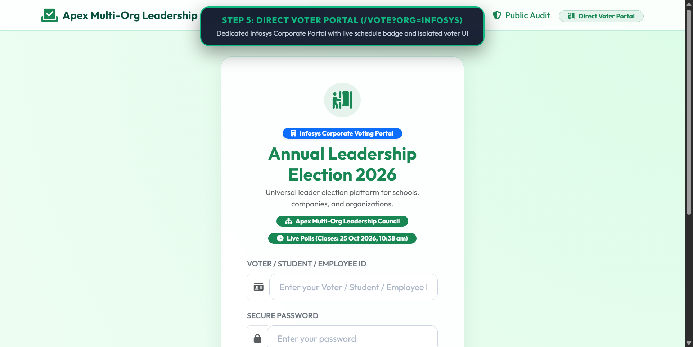 | 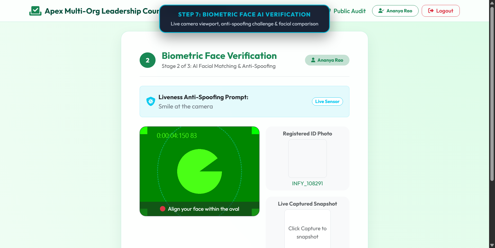 |
| **Two-Factor OTP Security** | **Digital Ballot with Live Countdown** |
| 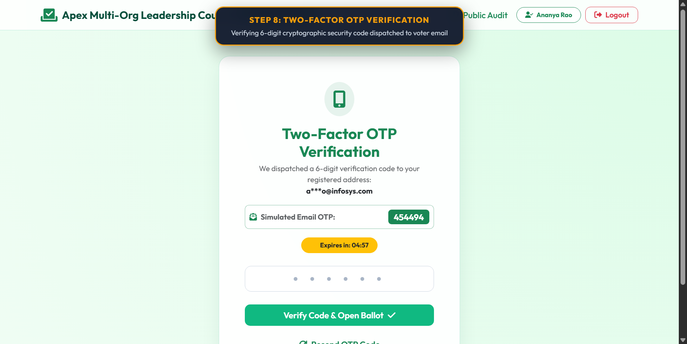 | 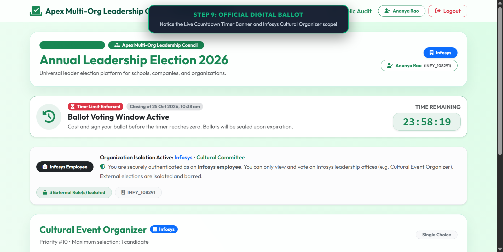 |
| **Atomic Ballot Preview & Review** | **Cryptographic Zero-Knowledge Receipt** |
| 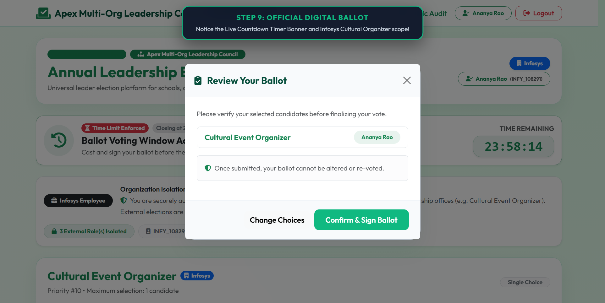 | 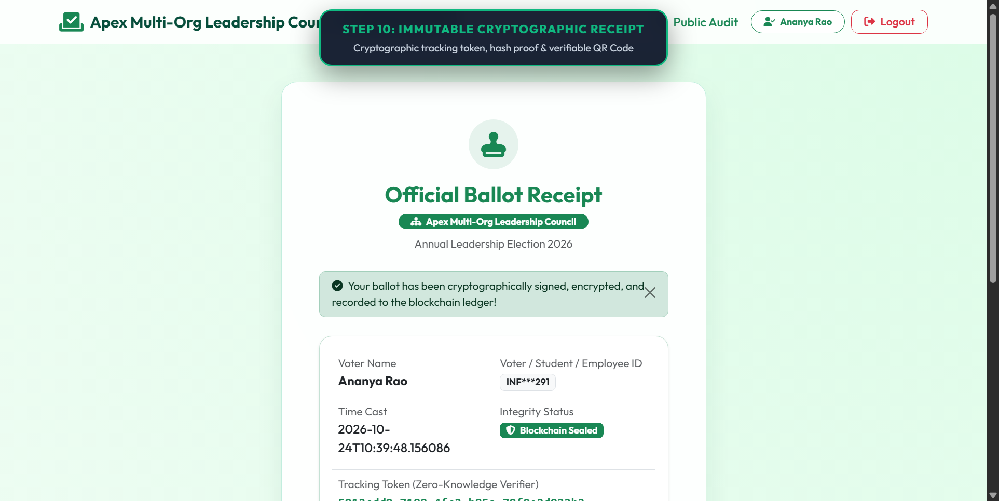 |

---

### 2. Administrator & Organizer Governance Portals
| Super Admin Master Dashboard | Election Time Limit & Scheduling |
| :---: | :---: |
| 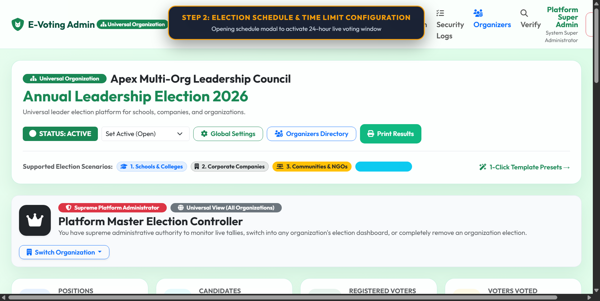 | 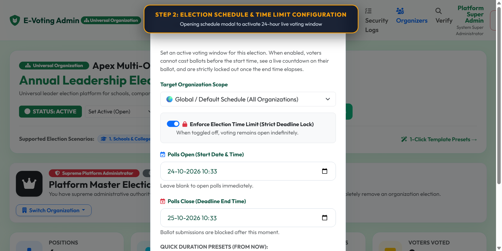 |
| **Instant Voter Access QR & Link Center** | **Scoped Tenant Dashboard (Infosys)** |
| 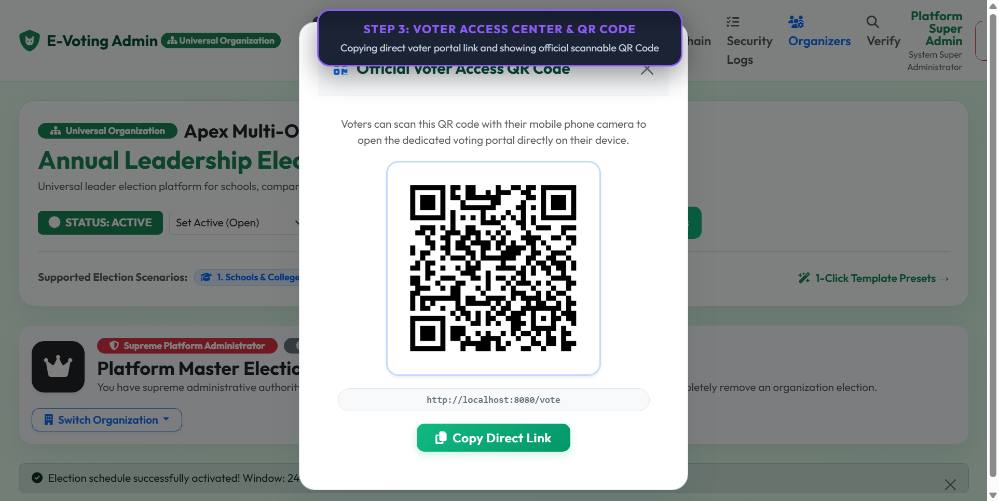 | 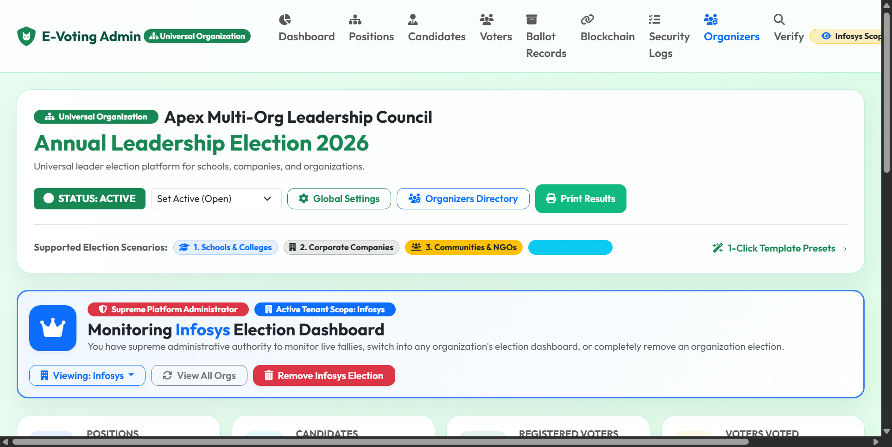 |

---

### 3. Cryptographic Audit & Blockchain Explorer
| Micro-Blockchain Immutable Ledger | Public Ledger Verification |
| :---: | :---: |
| 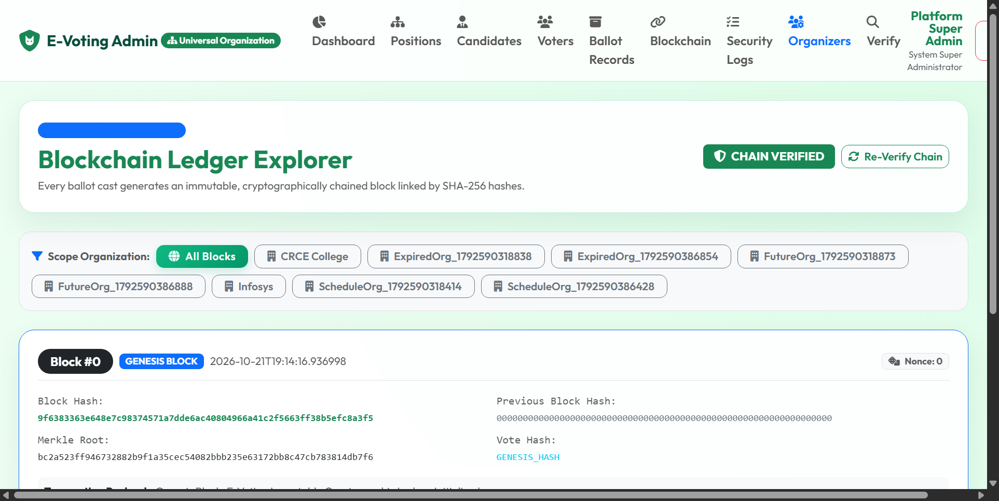 | 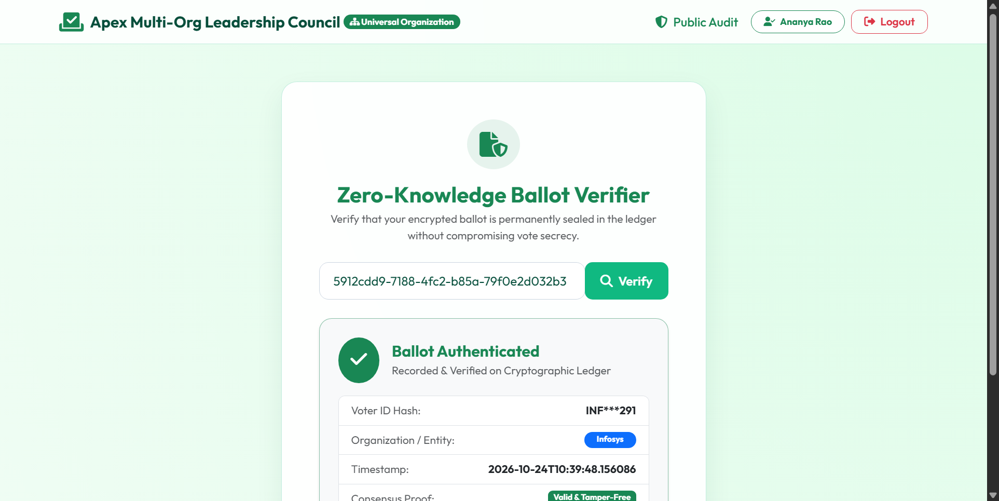 |

---

## 🧭 System Endpoints & Routing Architecture

The platform exposes clearly demarcated, role-guarded endpoints across the Voter Authentication Pipeline, Cryptographic Ballot Engine, Public Audit Ledgers, and Multi-Tenant Administration.

### 1. 🗳️ Voter Authentication & Ballot Pipeline
| Method | Route | Access Level | Description |
|:---:|:---|:---:|:---|
| `GET` | `/` | Public | Automatic entry router directing users to active authentication stage or login. |
| `GET` | `/login` | Public | Primary Voter ID authentication portal with dynamic institutional branding. |
| `GET` | `/vote` | Public | Direct voter ballot portal link. |
| `GET` | `/vote/{org}` | Public | Organization-scoped voter portal link (e.g. `/vote/Infosys`). |
| `POST` | `/login` | Public | Validates voter identifier and BCrypt hashed credentials; initiates biometrics. |
| `GET` | `/verify-face` | Voter (Session) | Renders biometric AI liveness challenge and webcam capture canvas. |
| `POST` | `/verify-face` | Voter (Session) | Submits captured face for OpenCV/DeepFace AI matching or emergency bypass. |
| `GET` | `/verify-otp` | Voter (Session) | Renders two-factor authentication (2FA) input with 5-minute expiry countdown. |
| `POST` | `/verify-otp` | Voter (Session) | Validates time-bounded 6-digit cryptographic OTP. |
| `POST` | `/resend-otp` | Voter (Session) | Dispatches fresh OTP with 30-second rate-limiting cooldown. |
| `GET` | `/ballot` | Voter (Authenticated) | Scoped electronic ballot restricted to voter's organization and electorate division. |
| `POST` | `/ballot/submit` | Voter (Authenticated) | **Atomic Ballot Sealing**: Executes AES-256 encryption, RSA-2048 signing, SHA-256 hashing, and micro-blockchain block generation. |
| `GET` | `/receipt` | Voter (Authenticated) | Displays zero-knowledge receipt with Tracking Token UUID and ZXing QR code. |
| `GET` | `/logout` | Voter | Terminates voter session and invalidates active authentication tokens. |

### 2. 🔗 Public Cryptographic Audit & Verification
| Method | Route | Access Level | Description |
|:---:|:---|:---:|:---|
| `GET` | `/verify-votes` | Public | Real-time public audit dashboard with micro-blockchain explorer, Genesis block validation, and tamper-detection health. |
| `GET` | `/verify-receipt` | Public | Zero-knowledge ballot verification tool allowing voters to inspect their sealed vote in the immutable ledger via UUID or QR scan. |
| `GET` | `/api/election-results` | Public REST | JSON API returning live authenticated vote tallies, candidate statistics, and voter turnout metrics. |

### 3. 🏢 Platform Administration & Multi-Tenant Governance
| Method | Route | Access Level | Description |
|:---:|:---|:---:|:---|
| `GET` | `/admin/login` | Public | Administrative sign-in portal. |
| `POST` | `/admin/login` | Public | Authenticates administrators with BCrypt and loads tenant-specific session scope. |
| `GET` | `/admin/logout` | Admin | Clears administrative session tokens and returns to login. |
| `GET` | `/admin/register-organizer` | Public | Self-service organization onboarding portal (independent tenant creation). |
| `POST` | `/admin/register-organizer` | Public | Provisions new organization tenant, administrator account, and starter office. |
| `GET` | `/admin/dashboard` | Admin | Master command dashboard: analytics cards, Chart.js tallies, voter QR center, and election timer. |
| `GET` | `/admin/positions` | Admin | Position roster with division scoping (Student, Corporate, NGO, All). |
| `POST` | `/admin/positions/save` | Admin | Creates or updates an election office with maximum allowable vote constraints. |
| `POST` | `/admin/positions/delete` | Admin | Safely deletes a position and cascades candidate relationships. |
| `GET` | `/admin/candidates` | Admin | Candidate management console with party symbols, bios, and portrait uploads. |
| `POST` | `/admin/candidates/save` | Admin | Registers candidate profile, platform statement, and organizational tag. |
| `POST` | `/admin/candidates/delete` | Admin | Removes candidate from ballot rosters. |
| `GET` | `/admin/voters` | Admin | Voter registration directory partitioned by organizational boundaries. |
| `POST` | `/admin/voters/save` | Admin | Provisions voter account with alphanumeric ID, credentials, and facial reference. |
| `POST` | `/admin/voters/update` | Admin | Updates voter details and contact email. |
| `POST` | `/admin/voters/delete` | Admin | Removes voter profile from roll. |
| `GET` | `/admin/votes` | Admin | Inspects live cast ballots, decrypted payload mirrors, and cryptographic signatures. |
| `POST` | `/admin/votes/reset` | Admin | Administrative election ballot purge with confirmation safeguard. |
| `POST` | `/admin/votes/simulate-tamper` | Admin | Interactive tamper simulator for demonstration and audit engine testing. |
| `GET` | `/admin/blockchain` | Admin | Detailed micro-blockchain ledger inspector (block height, previous hash, Merkle root, nonce). |
| `GET` | `/admin/audit` | Admin | Security audit trail recording onboarding, logins, schedule changes, and anomalies. |
| `GET` | `/admin/print` | Admin | Certified official election declaration certificate with digital seal and winner rankings. |
| `GET` | `/admin/profile` | Admin | Administrator profile, password updates, and universal branding configuration. |
| `POST` | `/admin/profile/update` | Admin | Updates administrator profile credentials and credentials photo. |
| `POST` | `/admin/election/status` | Super Admin | State machine toggling global election status (`ACTIVE`, `PAUSED`, `CONCLUDED`). |
| `POST` | `/admin/election/schedule` | Admin | Sets election start/end time windows and activates real-time countdown lockouts. |
| `POST` | `/admin/election/settings` | Admin | Customizes organization name, institution type, badge terminology, and ID label. |
| `POST` | `/admin/election/apply-preset` | Super Admin | 1-Click institutional preset loader (School/College, Corporate, Society, Civic). |
| `GET` | `/admin/organizers` | Super Admin | Multi-tenant organizer governance portal managing all registered organizations. |
| `POST` | `/admin/organizers/save` | Super Admin | Creates or edits organization organizer accounts and tenant privileges. |
| `POST` | `/admin/organizers/delete/{id}` | Super Admin | Removes organizer credentials while retaining scoped election records. |
| `POST` | `/admin/organization/delete-election` | Super Admin | Cascade purges entire election tenant (positions, candidates, and votes). |

---

## 🏢 Multi-Organization & Multi-Context Leader Selection

The platform is designed to conduct leader elections for any institution, organization, or assembly:

### 1. 🎓 Schools, Colleges & Universities
* **Context**: Student Union, Prefect Council, Departmental Associations.
* **Standard Offices**: Student Council President / Head Boy, Vice President / Head Girl, Sports Captain, Cultural & Arts Secretary, Class / House Representatives.
* **Electorate ID**: Student Roll Number / PRN / Campus Card ID.
* **Candidate Badge**: House Crest / Club Insignia / Student Badge.

### 2. 🏢 Corporate Companies & Enterprises
* **Context**: Board of Directors, Employee Advisory Council, Steering Committees.
* **Standard Offices**: Board of Directors (Shareholder Reps), Employee Advisory Committee, Innovation & Technology Lead, Workplace Safety & Welfare Officer.
* **Electorate ID**: Corporate Employee ID / SSO Workday ID.
* **Candidate Badge**: Division Emblem / Business Unit Logo.

### 3. 👥 Communities, Clubs, Societies & NGOs
* **Context**: Residential Welfare Associations (RWA), Non-Profit Boards, Professional Societies.
* **Standard Offices**: President / Chairperson, General Secretary, Treasurer & Financial Auditor, Executive Committee Members.
* **Electorate ID**: Membership Card Number / Registration Number.
* **Candidate Badge**: Society Seal / Chapter Crest / Logo.

### 4. 🏛️ Civic & Public Democratic Bodies
* **Context**: Legislative, Parliamentary, and Municipal Assemblies.
* **Standard Offices**: Member of Legislative Assembly (MLA), Member of Parliament (MP), Mayor / Ward Councillor.
* **Electorate ID**: Electoral Photo Identity Card (EPIC / Voter ID).
* **Candidate Badge**: Official Party Symbol / Election Allotment.

> **1-Click Switching**: Administrators can switch between any of these presets directly from the Admin Dashboard or customize all parameters on `/admin/profile`.

---

## 🐛 Bugs Fixed from Legacy Codebase

1. **Cleartext OTP Leakage**: The legacy code printed the OTP in plain text on the voter's screen (`Your OTP: <?php echo $_SESSION['otp']; ?>`). Replaced with secure session storage, email dispatch, 5-minute expiry countdown timer, and simulated notifications in test mode.
2. **Weak Static IV in AES**: Fixed weak static IV in CBC mode by using standard cryptographic initialization vectors and automated padding.
3. **Fragile RSA Key Loading**: Removed brittle relative paths (`keys/public.pem`, `../keys/public.pem`). Keys are loaded cleanly via Spring configuration with automated keypair generation fallback.
4. **Concurrent Double-Voting Race Condition**: Made ballot submission `@Transactional(isolation = Isolation.SERIALIZABLE)` with database unique constraints on `(voters_id, position_id, candidate_id)`.
5. **Partial Ballot Insertion**: Multi-position ballot submissions are atomic; if any candidate selection is invalid, all inserts are rolled back.
6. **Missing Database Tables**: Created entities and tables for `audit_logs`, `tamper_logs`, `blockchain_ledger`, and `election_settings` which were missing from the SQL schema.
7. **Biometric Script Hang**: Added timeout protection, Java perceptual similarity fallback, and emergency passkey bypass so voters are never locked out if webcam or Python dependencies are absent.

---

## 🛠️ Technology Stack

* **Backend**: Java 21, Spring Boot 3.3.4 (Spring MVC, Spring Data JPA, Spring Security Crypto)
* **Templates**: Thymeleaf HTML5 with responsive Light Green Glassmorphism theme
* **Database**: Persistent H2 (MySQL compatibility mode for zero-setup execution) & Native MySQL 8.x Profile
* **Biometrics**: HTML5 MediaDevices Webcam API, Python `deepface` / `opencv-python`, Java Perceptual Image Matcher
* **Cryptography**: AES-256, RSA-2048, SHA-256, BouncyCastle, ZXing QR Code Engine
* **Frontend**: Bootstrap 5, FontAwesome 6, Chart.js, SweetAlert2

---

## 💻 How to Run the Application

### 1. Prerequisites
* **Java 21** or later installed and on your `PATH`.
* (Optional) **Python 3.8+** with `deepface` and `opencv-python` for AI face verification (fallback matcher is built-in).

### 2. Run with Embedded Zero-Setup Database (Recommended)
You do not need to install or configure MySQL. Simply execute the included Maven wrapper:

```bash
# Windows
.\mvnw.cmd spring-boot:run

# Linux / macOS
./mvnw spring-boot:run
```

Or run the pre-built standalone executable JAR:
```bash
java -jar target/face-verified-voting-system-1.0.0.jar
```

The application will start immediately on **`http://localhost:8080`**.

### 3. Cloud Database (TiDB Cloud Serverless) & Render Deployment
The application is pre-configured for zero-friction cloud deployment using **TiDB Cloud Serverless MySQL** and **Render**:
1. Connects seamlessly to TiDB Cloud over secure TLS (`VERIFY_IDENTITY`).
2. Multi-stage [`Dockerfile`](Dockerfile) and [`render.yaml`](render.yaml) included for automatic continuous deployment.
3. Automatically adapts to Render's dynamic `$PORT`.

---

## 🔑 Administrator Access

### Platform Super Administrator Portal (`/admin/login`)
* **Username**: `[Configured securely during initial setup]`
* **Password**: `[Configured securely via environment variables / setup]`
* **Role**: `SUPER_ADMIN` (Full administrative governance over multi-tenant elections, organizers, and cryptographic audit)

### Independent Public Cryptographic Audit
* Navigate to **`http://localhost:8080/verify-votes`** to view real-time cryptographic audit results and micro-blockchain ledger verification.
